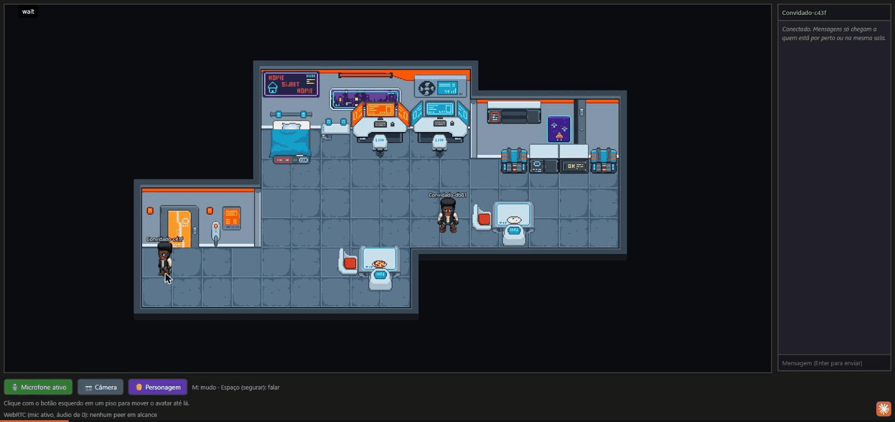

# MyGather

Clone simplificado do [Gather Town](https://www.gather.town/): um escritório
virtual 2D em pixel art onde cada pessoa controla um avatar e o **áudio liga
sozinho quando os avatares se aproximam**. Também tem vídeo, chat e salas
fechadas.

Foi feito para uso real por uma equipe pequena, de até algumas dezenas de
pessoas simultâneas, e não só como exercício. O servidor valida movimento,
autentica por token, limita taxa de eventos e retoma a sessão após quedas.

<p align="center">
  
</p>
<p align="center"><sub>
  Áudio por proximidade: ao se aproximar, a conexão WebRTC abre e o anel do
  outro avatar pulsa <b>verde</b> enquanto ele fala (<b>amarelo</b> = só perto).
  Ao ligar o mudo, aparece o ícone vermelho. A "voz" da gravação é um sinal
  sintético injetado no lugar do microfone.
</sub></p>

```
┌──────────── navegador ────────────┐        ┌────────── servidor ──────────┐
│ Canvas 2D + TypeScript (Vite)     │ socket │ Node.js + Express + Socket.io │
│ • renderiza mapa e avatares       │◄──────►│ • posições autoritativas      │
│ • A* + colisão local              │   .io  │ • valida velocidade/colisão   │
│ • peers WebRTC (simple-peer)      │        │ • proximidade e salas         │
│ • chat, mudo, câmera, personagem  │        │ • signaling WebRTC e chat     │
└──────────────┬────────────────────┘        └───────────────────────────────┘
               │  áudio/vídeo P2P (mesh): não passa pelo servidor
               ▼
        outros navegadores
```

---

## Sumário

- [Funcionalidades](#funcionalidades)
- [Stack](#stack)
- [Início rápido](#início-rápido)
- [Como usar](#como-usar)
- [Configuração](#configuração)
- [Rodando na LAN / em produção](#rodando-na-lan--em-produção)
- [Editor de mapas](#editor-de-mapas)
- [Arquitetura](#arquitetura)
- [Protocolo Socket.io](#protocolo-socketio)
- [Endpoints HTTP](#endpoints-http)
- [Testes](#testes)
- [Estrutura de pastas](#estrutura-de-pastas)
- [Limitações conhecidas](#limitações-conhecidas)
- [Documentação detalhada](#documentação-detalhada)
- [Créditos](#créditos)

---

## Funcionalidades

| Área | O que faz |
|---|---|
| **Movimento** | Clique num piso: o avatar calcula o menor caminho (A\*, 4 direções) e anda até lá suavemente. Um novo clique recalcula a rota. |
| **Multiplayer** | Todos veem todos em tempo real. O cliente envia a posição cerca de 20 vezes por segundo, e o servidor retransmite para os outros. |
| **Proximidade** | Abaixo de **150 px** os avatares se conectam. Acima de **170 px** desconectam. A diferença entre os dois limites (histerese) evita que a conexão fique ligando e desligando na borda. |
| **Áudio/vídeo** | WebRTC P2P em malha (mesh), via `simple-peer`. Liga automaticamente quando alguém entra no alcance. A câmera é opcional e reaproveita a mesma conexão do áudio. |
| **Salas fechadas** | Zonas `room` do mapa: quem está dentro ouve todos da sala, independentemente da distância, e **não** ouve quem está fora, mesmo do outro lado da parede. |
| **Chat** | Mensagens chegam só a quem está no alcance ou na mesma sala, e aparecem no painel lateral e em balões acima do avatar. São efêmeras: nada é salvo. |
| **Indicadores** | Nome acima do avatar. Anel **amarelo** quando o outro está perto e **verde** quando está falando (volume acima do limiar). Ícone vermelho quando está mudo. |
| **Mudo / push-to-talk** | `M` liga e desliga o mudo. Com o mudo ligado, segurar `Espaço` fala enquanto a tecla estiver apertada. |
| **Personagens** | 4 personagens em pixel art (LPC), com animação de andar e parado nas 4 direções. A escolha aparece igual para todos. |
| **Editor de mapas** | `editor.html`: pinta piso, parede e objeto, define spawn e salas, e importa/exporta o `map.json`. |
| **Segurança** | Movimento validado no servidor (velocidade e colisão), token de acesso, CORS restrito, limite de taxa por IP e por evento. |
| **Reconexão** | Após uma queda, o jogador volta com a mesma posição, nome e estado de mudo (janela de 60 s). |
| **HTTPS / TURN** | HTTPS/WSS opcional, necessário para usar o microfone fora de `localhost`. Suporte a TURN (coturn) com credenciais temporárias, pronto para ligar quando for preciso. |

## Stack

- **Cliente:** TypeScript puro + HTML5 Canvas (sem framework de UI), empacotado com [Vite](https://vitejs.dev/), mais [`simple-peer`](https://github.com/feross/simple-peer) e `socket.io-client`.
- **Servidor:** Node.js + Express + [Socket.io](https://socket.io/), executado com [`tsx`](https://github.com/privatenumber/tsx) em desenvolvimento.
- **Mídia:** WebRTC em mesh (P2P direto entre clientes). STUN público em dev, e TURN opcional via coturn.
- **Estado:** em memória. **Não há banco de dados**: reiniciar o servidor apaga sessões e posições.
- **Testes:** test runner nativo do Node (`node --test`) + `tsx`, sem framework adicional.

---

## Início rápido

**Pré-requisitos:** Node.js 20+ (testado no 24) e npm.

```bash
# 1. dependências (uma vez)
npm --prefix server install
npm --prefix client install

# 2. servidor (terminal 1): http://localhost:3000
cd server
npm run dev

# 3. cliente (terminal 2): http://localhost:5173
cd client
npm run dev
```

Abra **http://localhost:5173**. Para ver o multiplayer funcionando, abra o link
em **duas abas** (ou dois navegadores) e aproxime os avatares.

Em desenvolvimento **nenhum `.env` é necessário**: sem token, com CORS aberto e
STUN público.

> **Dica:** abas em segundo plano têm o `requestAnimationFrame` pausado pelo
> navegador. O avatar de uma aba que não está visível pode parecer parado para
> os outros até você voltar a ela. Isso é comportamento do navegador, não um bug.

---

## Como usar

| Ação | Como |
|---|---|
| Andar | Clique com o botão esquerdo num piso |
| Mudo liga/desliga | `M` ou botão **🎙️ Microfone** |
| Falar com o mudo ligado (push-to-talk) | Segure `Espaço` |
| Câmera | Botão **📷 Câmera** |
| Trocar personagem | Botão **Personagem** |
| Mudar o nome | Campo de nome no topo do painel lateral |
| Chat | Digite no campo do painel e pressione `Enter` |

O status do WebRTC aparece no rodapé, por exemplo
`WebRTC (mic ativo, áudio de 1): abc123=connected`.

Sem microfone ou com a permissão negada, o botão vira **🚫 Sem microfone** e o
resto do app continua funcionando. O mesmo vale para a câmera.

---

## Configuração

### Servidor (`server/.env`)

O servidor lê tudo de `process.env`. **Ele não carrega o `.env` sozinho.**
Exporte as variáveis no shell ou use `node --env-file=.env` (Node 20+).

```bash
# bash
AUTH_TOKEN=meu_token npm --prefix server run dev
```
```powershell
# PowerShell
$env:AUTH_TOKEN = "meu_token"; npm --prefix server run dev
```

| Variável | Padrão | Descrição |
|---|---|---|
| `PORT` | `3000` | Porta HTTP/WS do servidor |
| `AUTH_TOKEN` | *(vazio = acesso aberto)* | Token compartilhado. Se estiver definido, só conecta quem apresentar o token |
| `ALLOWED_ORIGINS` | *(vazio = qualquer origem)* | Origens permitidas, separadas por vírgula (Socket.io e HTTP) |
| `RL_CONN_RATE` / `RL_CONN_BURST` | `5` / `40` | Conexões por IP: taxa por segundo e pico permitido |
| `RL_MOVE_RATE` | `30` | Eventos `move` por segundo, por socket (o cliente envia ~20) |
| `RL_CHAT_RATE` | `2` | Mensagens de chat por segundo, por socket |
| `RL_SIGNAL_RATE` | `40` | Mensagens de signaling WebRTC por segundo, por socket |
| `SESSION_GRACE_MS` | `60000` | Por quanto tempo o estado fica guardado para quem reconectar |
| `PING_INTERVAL_MS` / `PING_TIMEOUT_MS` | `25000` / `20000` | Detecção de queda do Socket.io |
| `PROXIMITY_ENTER` / `PROXIMITY_LEAVE` | `150` / `170` | Raios de proximidade em px (entrar/sair, com histerese) |
| `PROXIMITY_TICK_MS` | `100` | Intervalo do cálculo de proximidade |
| `CLIENT_SPEED` / `SPEED_TOLERANCE` | `160` / `1.5` | Velocidade esperada (px/s) e tolerância usadas na validação |
| `STUN_URLS` | STUN público | Servidores STUN, separados por vírgula |
| `TURN_URLS` | *(vazio = TURN desligado)* | URLs `turn:`/`turns:`, separadas por vírgula |
| `TURN_SECRET` | — | Segredo compartilhado com o coturn (`static-auth-secret`) |
| `TURN_TTL_SECONDS` | `43200` | Validade das credenciais TURN temporárias (12 h) |
| `TLS_CERT` / `TLS_KEY` | — | Certificado e chave. Com os dois definidos, o servidor sobe em HTTPS/WSS |

Há um modelo comentado em [server/.env.example](server/.env.example).
**Não copie o arquivo direto para desenvolvimento:** ele traz valores de exemplo
de STUN/TURN (`turn.seu-dominio.com`) que quebram o WebRTC se ficarem ativos.

Para gerar um token forte:

```bash
node -e "console.log(require('crypto').randomBytes(24).toString('base64url'))"
```

### Cliente (`client/.env`)

| Variável | Padrão | Descrição |
|---|---|---|
| `VITE_SERVER_URL` | `<protocolo>//<host da página>:3000` | URL do servidor. Só é necessária se ele estiver em outro host ou porta |
| `TLS_CERT` / `TLS_KEY` | — | Servem o dev server do Vite em HTTPS (lidas do ambiente) |

### Parâmetros de URL

| Parâmetro | Efeito |
|---|---|
| `?token=…` | Token de acesso. Fica salvo no `localStorage` e é removido da barra de endereço |
| `?forceRelay=1` | Proíbe o P2P direto (`iceTransportPolicy: 'relay'`). Serve para comprovar que o TURN está funcionando |

---

## Rodando na LAN / em produção

Fora de `localhost`, o navegador **só libera o microfone com HTTPS**. Para
rodar numa rede local:

```bash
# certificado de dev cobrindo localhost + o IP da máquina
infra/gen-dev-cert.sh 192.168.1.20

# servidor e cliente em HTTPS com o mesmo cert
TLS_CERT=infra/certs/cert.pem TLS_KEY=infra/certs/key.pem npm --prefix server run dev
TLS_CERT=infra/certs/cert.pem TLS_KEY=infra/certs/key.pem npm --prefix client run dev
```

Acesse `https://192.168.1.20:5173` dos outros dispositivos e aceite o aviso do
certificado self-signed uma vez em cada um. Com o [mkcert](https://github.com/FiloSottile/mkcert)
o aviso não aparece. O cliente deriva a URL do servidor sozinho: a página em
`https://…:5173` conecta em `wss://…:3000`.

Para uso real com a equipe, use também:

1. `AUTH_TOKEN` com um valor forte. Compartilhe o link `https://HOST:5173/?token=…`.
2. `ALLOWED_ORIGINS` com a origem real do cliente.
3. Build de produção:

   ```bash
   npm --prefix server run build && npm --prefix server start   # node dist/index.js
   npm --prefix client run build   # gera client/dist (index.html + editor.html)
   ```

   Sirva `client/dist` com qualquer servidor estático com HTTPS.

**TURN:** a implementação está pronta, mas fica desligada por padrão. Para a
maioria das redes domésticas, STUN + P2P direto basta. Se alguém em 4G/CGNAT ou
numa rede corporativa restritiva não for ouvido pelos outros, suba um coturn
com [infra/turnserver.conf](infra/turnserver.conf) e preencha `TURN_URLS` e
`TURN_SECRET`. O passo a passo está em
[docs/hardening-turn-https.md](docs/hardening-turn-https.md).

---

## Editor de mapas

Abra **http://localhost:5173/editor.html**.

- **Pintar:** Piso / Parede / Objeto / Apagar (clique ou arraste).
- **Spawn:** clique num piso.
- **Sala:** arraste um retângulo e digite o `roomId`.
- **Novo / Importar / Exportar** `map.json`.

Fluxo: edite → **Exportar** → substitua [client/src/map.json](client/src/map.json)
→ **reinicie o servidor** (ele lê o mesmo arquivo para validar movimento e
salas).

O editor valida com o mesmo [client/src/mapschema.ts](client/src/mapschema.ts)
que o jogo usa, então não dá para exportar um mapa que o cliente rejeitaria.

### Formato do `map.json` (resumo)

- `tiles`: grade de `floor` | `wall` | `object`. É a **única** fonte de colisão.
- `spawn`: ponto de entrada.
- `rooms`: retângulos com `roomId` (zonas de áudio compartilhado).
- `decor`: móveis de chão. `decals`: monitores, letreiros e painéis montados na parede (só visual).
- `tileStyles`: cor/sprite por tipo de tile, com cor sólida como fallback quando não há sprite.

As convenções de montagem com o tileset cyberpunk (parede em 2 fileiras, friso,
decals etc.) estão na seção 8 da
[especificação](docs/spec-gather-clone.md#8-etapa-8--arte-pixelada).

---

## Arquitetura

### Servidor autoritativo

O cliente **sugere** posições, e quem decide é o servidor:

1. A cada `move`, o servidor confere a **velocidade**, com uma folga de tempo
   que permite pequenas rajadas e se recarrega com o tempo, e a **colisão**
   contra o mesmo `map.json`.
2. Se o movimento for inválido (teleporte, atravessar parede, velocidade
   alta demais), o servidor envia `position:correction` e o cliente volta para
   a última posição válida.
3. O spawn também é decidido pelo servidor: o cliente não escolhe onde nasce.

Por isso o isolamento das **salas fechadas** é uma garantia de privacidade, e
não algo apenas visual. Um cliente modificado não entra numa sala sem passar
pela porta. Os testes de integração em `forgery.test.ts` cobrem exatamente esse
cenário.

### Proximidade e salas

A cada `PROXIMITY_TICK_MS` (100 ms) o servidor percorre os pares de jogadores:

- **Mesma sala** → conectados, independentemente da distância.
- **Um dentro de uma sala e o outro fora** (ou em salas diferentes) → nunca conectados.
- **Os dois fora de salas** → conectam a ≤ 150 px e desconectam a > 170 px.

Mudanças viram eventos `peer:enter` / `peer:leave` para os dois lados. Esses
eventos disparam a criação ou o encerramento da conexão WebRTC no cliente, e
também definem quem recebe o chat.

### Mídia (WebRTC mesh)

- O servidor só faz o **signaling** (repassa `signal` entre os pares). Áudio e
  vídeo vão direto de navegador para navegador.
- O microfone é pedido **antes** de conectar, para que as conexões já nasçam
  com áudio.
- Ligar a câmera adiciona a faixa de vídeo na mesma conexão e renegocia a
  sessão. Não cria um peer novo nem passa pelo servidor.
- O mudo usa `track.enabled = false`: o navegador passa a enviar silêncio sem
  derrubar a conexão.
- O indicador de "falando" vem de um `AnalyserNode` por stream, que mede o
  volume (RMS) e compara com o limiar `0.045`.

### Reconexão

O cliente gera um `sessionId` (UUID) e o guarda no `localStorage`. Esse id vai
junto em cada conexão. Quando alguém cai, o servidor guarda por 60 s a **última
posição que ele mesmo validou**, além do nome e do mudo. Se a pessoa reconectar
dentro desse prazo, esse estado é restaurado. O cliente nunca envia
coordenadas na reconexão, então isso não reabre o furo de teleporte.

---

## Protocolo Socket.io

**Handshake** (`auth`): `{ token?, sessionId }`.

| Cliente → Servidor | Payload | Observação |
|---|---|---|
| `move` | `{ x, y }` | Validado (velocidade e colisão) e com limite de taxa |
| `signal` | `{ to, data }` | Signaling WebRTC, repassado ao destinatário |
| `chat` | `{ text }` | Espaços nas pontas removidos e texto cortado em 500 caracteres. Vai para quem está no alcance ou na mesma sala |
| `rename` | `{ name }` | Até 24 caracteres |
| `mute` | `{ muted }` | Faz aparecer o ícone de mudo para os outros |
| `setCharacter` | `{ character }` | Personagem escolhido |

| Servidor → Cliente | Payload | Quando |
|---|---|---|
| `welcome` | id, estado inicial, jogadores, `iceServers` | Ao conectar |
| `player:joined` / `player:left` | jogador / `{ id }` | Entrada e saída |
| `player:moved` | jogador | Movimento aceito |
| `position:correction` | `{ x, y }` | Movimento rejeitado |
| `peer:enter` / `peer:leave` | `{ id }` | Proximidade ou sala mudou |
| `signal` | `{ from, data }` | Signaling de outro peer |
| `chat` | mensagem | Mensagem no alcance (com eco ao remetente) |
| `player:renamed` / `player:muted` / `player:character` | `{ id, … }` | Mudança de nome, mudo ou personagem |

## Endpoints HTTP

| Rota | Descrição |
|---|---|
| `GET /health` | Diagnóstico: jogadores conectados, rejeições de movimento e descartes por limite de taxa. Exige `?token=` quando a autenticação está ligada |
| `GET /ice` | `iceServers` atuais (STUN + credenciais TURN temporárias). Exige `?token=` quando a autenticação está ligada |

---

## Testes

```bash
npm test              # na raiz: servidor + cliente
npm run typecheck     # tsc --noEmit nos dois projetos

npm run test:server   # unitários + paridade + integração
npm run test:client   # pathfinding, colisão, schema do mapa

# dentro de server/
npm run test:unit          # rápido, sem rede
npm run test:integration   # sobe o servidor real numa porta livre
```

| Suíte | Cobre |
|---|---|
| `client/test/` | A\*, colisão (`moveWithCollision`), validação do schema do mapa |
| `server/test/unit/` | Validação de movimento, proximidade com histerese, precedência de salas, limite de taxa, sessões, ICE/TURN, mapa compartilhado |
| `server/test/collision-parity.test.ts` | Garante que cliente e servidor tratam as bordas de colisão do mesmo jeito: onde o cliente para tem de ser a última posição que o servidor considera livre |
| `server/test/integration/` | Clientes Socket.io reais que andam legalmente: proximidade, salas, chat, autenticação, limite de taxa, reconexão, mudo, HTTPS/ICE e **ataques forjados** (handshake, teleporte, rajada) |

Os testes de navegador (renderização do canvas, áudio WebRTC real) foram
validados manualmente e com Playwright durante o desenvolvimento, mas **não
estão versionados**. Mais detalhes em [TESTING.md](TESTING.md).

---

## Estrutura de pastas

```
MyGather/
├── client/                    # Vite + TypeScript + Canvas
│   ├── index.html             # o jogo
│   ├── editor.html            # o editor de mapas
│   ├── vite.config.ts         # HTTPS opcional, polyfills do simple-peer
│   ├── src/
│   │   ├── main.ts            # entrypoint, game loop, UI (mic, câmera, chat)
│   │   ├── canvas.ts          # renderização (mapa, avatares, anéis, nomes, balões)
│   │   ├── player.ts          # avatar local, seguir caminho
│   │   ├── pathfinding.ts     # A* na grade de tiles
│   │   ├── collision.ts       # colisão AABB com o mapa
│   │   ├── network.ts         # cliente Socket.io
│   │   ├── webrtc.ts          # PeerManager: peers, áudio, vídeo, "falando"
│   │   ├── chat.ts            # painel e balões de chat
│   │   ├── avatar.ts · characters.ts · spritesheet.ts   # sprites e animação
│   │   ├── tileset.ts · tilestyle.ts · catalog.ts       # arte do mapa
│   │   ├── mapschema.ts       # validação do map.json (compartilhada c/ servidor)
│   │   ├── editor.ts          # editor de mapas
│   │   ├── map.json           # mapa em uso (lido pelo cliente E pelo servidor)
│   │   └── assets/            # personagens LPC, tileset cyberpunk
│   └── test/
├── server/                    # Node + Express + Socket.io
│   ├── src/
│   │   ├── index.ts           # entrypoint, eventos, auth, CORS, HTTPS
│   │   ├── movement.ts        # validação de velocidade e colisão
│   │   ├── rooms.ts           # proximidade (histerese) e salas
│   │   ├── sessions.ts        # estado guardado para reconexão
│   │   ├── ratelimit.ts       # limite de taxa (token bucket)
│   │   ├── ice.ts             # STUN/TURN e credenciais temporárias
│   │   └── types.ts
│   └── test/                  # unit/, integration/, fixtures/, helpers/
├── infra/
│   ├── gen-dev-cert.sh        # certificado self-signed para HTTPS em dev
│   └── turnserver.conf        # configuração do coturn
├── docs/                      # especificação e notas de cada item da Fase 2
├── CREDITS.txt                # atribuição de arte (obrigatória: CC-BY-SA)
└── TESTING.md
```

---

## Limitações conhecidas

- **Mesh não escala para multidões.** Cada pessoa abre uma conexão com cada
  pessoa no alcance. Funciona bem para grupos pequenos. Com muita gente
  aglomerada (sobretudo com vídeo), seria preciso migrar para um SFU como
  LiveKit ou mediasoup.
- **Sem persistência.** Reiniciar o servidor apaga sessões, posições e o
  estado do chat.
- **Token único para todos.** Não há identidade por pessoa nem revogação
  individual. Para revogar, troque o token.
- **O limite de conexões é por IP.** Um escritório inteiro atrás de um único
  IP divide o mesmo limite. Atrás de um proxy reverso, o servidor vê o IP do
  proxy.
- **TURN entre redes realmente diferentes não foi testado em produção**, apenas
  contra um coturn local com `?forceRelay=1`.
- **Duas abas do mesmo navegador** compartilham o `sessionId` (vem do
  `localStorage`).
- **Editor sem desfazer/refazer**, salas apenas retangulares, e é preciso
  trocar o arquivo à mão e reiniciar o servidor.
- **Sem layout mobile** nem compartilhamento de tela.

## Documentação detalhada

| Documento | Assunto |
|---|---|
| [docs/spec-gather-clone.md](docs/spec-gather-clone.md) | Especificação: escopo, etapas 1–8, critérios de aceite, Fase 2 |
| [docs/hardening-auth.md](docs/hardening-auth.md) | Autenticação por link com token |
| [docs/hardening-ratelimit-cors.md](docs/hardening-ratelimit-cors.md) | Limite de taxa e CORS |
| [docs/hardening-reconnect.md](docs/hardening-reconnect.md) | Reconexão preservando a sessão |
| [docs/hardening-turn-https.md](docs/hardening-turn-https.md) | TURN (coturn) e HTTPS |
| [docs/product-video.md](docs/product-video.md) | Liga/desliga da câmera |
| [docs/product-map-editor.md](docs/product-map-editor.md) | Editor de mapas |
| [TESTING.md](TESTING.md) | Suíte de testes |

## Créditos

- **Personagens:** [Universal LPC Spritesheet Character Generator](https://liberatedpixelcup.github.io/Universal-LPC-Spritesheet-Character-Generator/).
  Licença **CC-BY-SA 3.0**, com atribuição obrigatória.
- **Tiles:** [Pixel Cyberpunk Interior](https://livingtheindie.itch.io/pixel-cyberpunk-interior),
  de DyLESTorm (livingtheindie). Uso livre, sem revenda ou redistribuição
  separada.

A lista completa de autores e as condições estão em [CREDITS.txt](CREDITS.txt).
